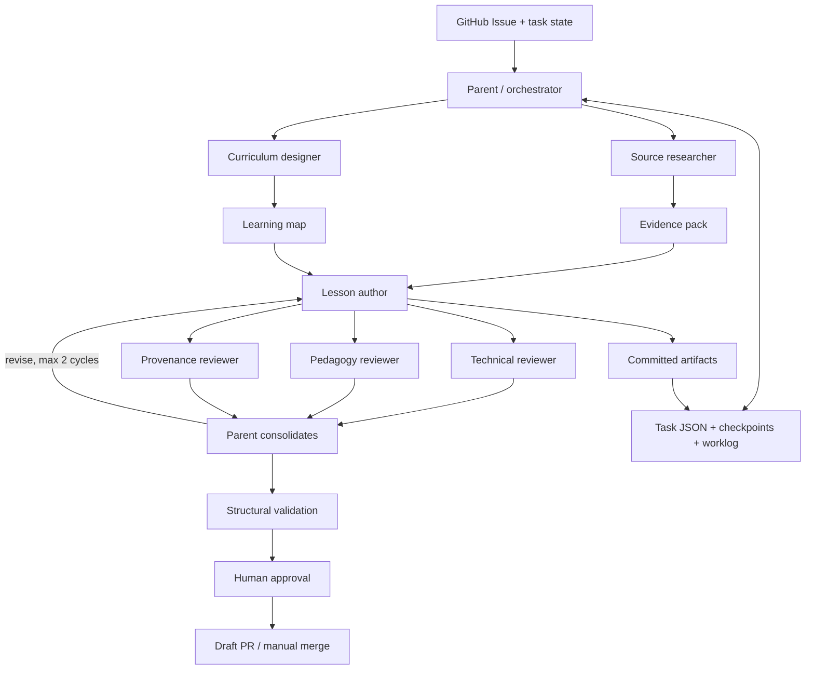

# Agent Architecture

## Four layers

| Layer | Responsibility | Repository location |
|---|---|---|
| Skills | Reusable procedures: how to research, write, assess, review, intake, and hand off | `.agents/skills/<skill-name>/SKILL.md` |
| Custom subagents | Specialist roles and task instructions | `.codex/agents/<agent-name>.toml` |
| Orchestration | Parent chooses sequence, delegates work, manages retries, and synthesizes results | `module-pipeline` skill + root `AGENTS.md` |
| Persistent task state | Cross-session/provider memory, checkpoints, idempotency, artifact hashes | GitHub Issues + `.academy/state/` + Git commits |

A skill is not an autonomous agent. A custom agent is not a workflow engine. The parent owns orchestration. GitHub and repository artifacts are the durable record; chat history is not.

## Roles

- Parent/orchestrator: scope, task state, shared files, handoffs, decisions, final PR.
- `source_researcher`: claim-level source evidence.
- `curriculum_designer`: learning map and prerequisites.
- `lesson_author`: writes only assigned lesson files.
- `technical_reviewer`: independent factual review.
- `pedagogy_reviewer`: independent learning review.
- `provenance_reviewer`: citation, attribution, and asset-rights review.

## Execution graph

## Persistent memory and anti-repeat rules

- GitHub Issue: task identity, goal, acceptance criteria, owner, dependencies, high-level state, and PR link.
- `.academy/state/tasks/<TASK-ID>.json`: current step states, dependencies, input fingerprints, output hashes, active run, and next action.
- `.academy/state/worklog/<TASK-ID>.jsonl`: append-only event/checkpoint history.
- Git commits: durable outputs and audit trail. `taskctl complete` refuses to mark a step complete until outputs are tracked and clean.
- GitHub Project: optional board/table/roadmap view over Issues and PRs, not another place to store detailed execution state.

The task fingerprint includes declared input-file hashes, the step's `definition_version`, and dependency fingerprints/output hashes. A step is `SKIP` only when its current inputs and outputs still match the completion record. If a source, skill, prompt, template, profile, or upstream artifact changes, only affected work becomes stale. See `.academy/state/README.md` and `docs/task-state-and-idempotency.md`.

Before every multi-step run, read the Issue and state, inspect Git/PR status, and execute `python scripts/taskctl.py status <TASK-ID>`. `SKIP` means do not repeat; `RESUME` means use the checkpoint; `STALE` means inspect and selectively rerun; `BLOCKED` means resolve dependencies first.

## Safe parallelism

- Parallelize independent research and reviews.
- Parallelize authors only when every author owns distinct lesson and report paths.
- Never let multiple agents write the same lesson, source registry, manifest, task state, or module README.
- The parent updates shared files and owns task-state transitions.
- One active writer per task/lesson; use the GitHub Issue for ownership and the branch for scope. The task JSON is not a distributed lock, so separate clones must coordinate ownership before writing.

## Permissions: important limitation

Custom subagent TOML files define roles and instructions; they do **not** establish an independent sandbox or override the parent session's permission mode. A reviewer prompt saying "do not edit" is a behavioral instruction, not a hard security control. All subagents inherit the parent session's permissions. For an enforced read-only review, configure the parent/host session with read-only permissions or restrict its available tools. Use branch/worktree isolation and review the diff for write-scope control. Do not add `sandbox_mode` to these custom profiles expecting it to enforce access.

## Execution boundaries

Automated: source discovery, draft creation, diagrams/assessments, independent AI reviews, checkpointing, reuse checks, structural validation, and PR preparation.

Not guaranteed: factual truth, source availability, legal permission, executable lab correctness, learner outcomes, or expert approval. No automated merge or learner-facing publication.

## How to use

### Local Codex (CLI or IDE)

Open the repository as the working project. Codex discovers repository skills under `.agents/skills/` and project-scoped custom agent profiles under `.codex/agents/`. The project config caps spawned agents at four.

For a new or resumed task, use `task-intake` / `task-handoff` first, then `module-pipeline` for multi-lesson work. Example:

> Resume task SD-DB-INDEXES. Read the GitHub Issue and `.academy/state/` first. Run `python scripts/taskctl.py status SD-DB-INDEXES`. Do not repeat any SKIP step. Resume unchanged in-progress work from its checkpoint. Execute only READY steps, record checkpoints, commit each step's outputs, and mark them complete through taskctl. Use the module-pipeline role graph. Stop at draft PR; do not merge or publish.

### ChatGPT Work or another AI provider

Do not assume another provider loads local Codex custom-agent TOML profiles. Give it the role instructions explicitly. Any agent that can read the repository can use the same JSON/JSONL task state and `taskctl` protocol. If the environment cannot run repository scripts, it must still read the JSON and verify inputs/output hashes before deciding to skip; it must not claim `taskctl` validation succeeded.

### Context and cost

Each subagent performs its own model/tool work, so parallel agents use more tokens than a comparable single-agent run. Parallelize for genuinely independent research/reviews, not for sequential work or shared-file editing.