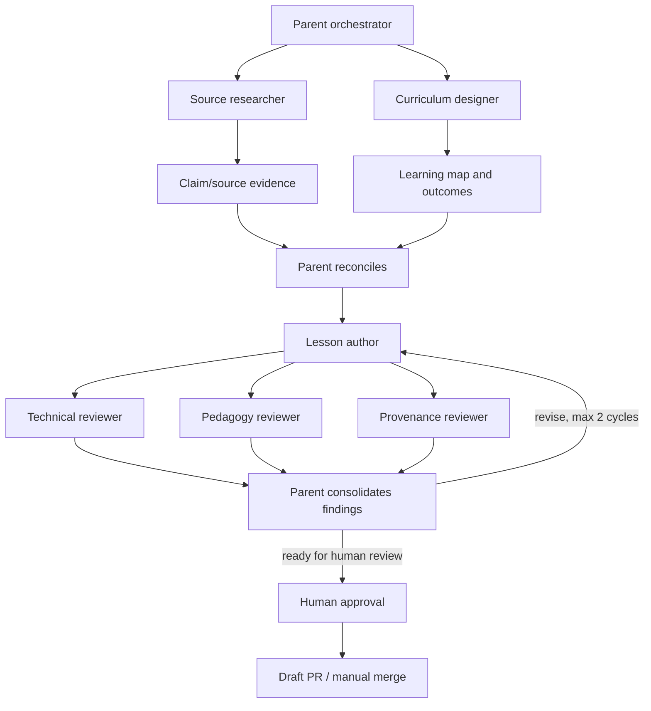

# Agent Architecture

## Three separate concepts

| Mechanism | Meaning | Repository location |
|---|---|---|
| Skill | Reusable procedure: how to research, write, assess, or review | `.agents/skills/<skill-name>/SKILL.md` |
| Custom subagent | Specialist worker with a defined role, instructions, and permissions | `.codex/agents/<agent-name>.toml` |
| Orchestration | Parent chooses sequence, delegation, parallel work, retries, and synthesis | `module-pipeline` skill + root `AGENTS.md` |

A skill is not an autonomous agent. A custom agent is not a workflow engine. Codex coordinates subagents; the parent owns the plan and combines results.

## Roles

- Parent/orchestrator: scope, task manifest, shared files, handoffs, decisions, final PR.
- `source_researcher`: read-only claim/source evidence.
- `curriculum_designer`: read-only learning map and prerequisites.
- `lesson_author`: writes only assigned lesson files.
- `technical_reviewer`: independent factual review.
- `pedagogy_reviewer`: independent learning review.
- `provenance_reviewer`: independent citation and asset-rights review.

## Execution graph

## Safe parallelism

- Parallelize read-only research and reviews.
- Parallelize authors only when every author owns distinct lesson and report paths.
- Never let multiple agents write the same lesson, source registry, manifest, or module README.
- The parent merges shared-file changes after workers finish.
- Concurrency is capped at four to manage context and usage.

## Automation boundaries

Automated: source discovery, draft creation, diagrams/assessments, independent AI reviews, structural validation, and PR preparation.

Not guaranteed: factual truth, source availability, legal permission, executable lab correctness, learner outcomes, or expert approval. No automated merge or learner-facing publication.
