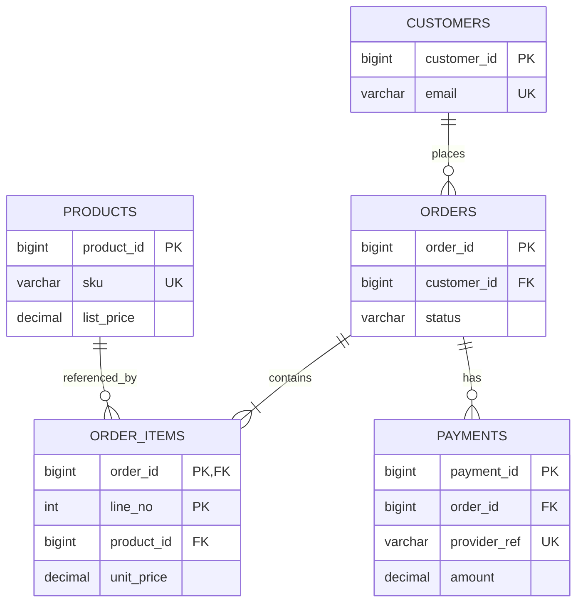

# DB-01 — Data Modeling and Relational Foundations

## 1. Learning outcomes

By the end of this lesson, you can:

- Turn use cases and access patterns into entities, relationships and constraints.
- Choose primary keys and foreign keys that preserve important invariants.
- Explain why normalization reduces certain update anomalies.
- Decide when denormalization is a deliberate performance/read-model trade-off.
- Identify what the database should enforce versus what belongs in application logic.

## 2. The problem: storing orders without corrupting business facts

Imagine an e-commerce service. It needs to answer:

- Which customer placed an order?
- Which products and quantities were purchased?
- What price was agreed at checkout?
- Has the payment been captured?
- Can an order refer to a customer or product that does not exist?

A naïve table might store `customer_name`, `product_name`, `quantity`, `price`, `payment_status` and all order data in one row. That becomes awkward when an order has multiple products, a customer changes their name, or product catalogue prices change. Copying the same facts into many rows creates update and consistency problems.

The key idea is to model stable business entities and their relationships, then select constraints that protect invariants even when multiple application instances write concurrently.

## 3. Start from requirements and access patterns

Before creating tables, write down:

1. **Entities:** Customer, Product, Order, OrderItem, Payment.
2. **Relationships:** one customer has many orders; one order has many order items; one product can appear in many order items.
3. **Invariants:** every order belongs to a customer; quantity is positive; each order item references an existing order and product; payment amount is non-negative.
4. **Access patterns:** load an order by ID; list a customer's orders newest first; fetch all items in an order; locate payment by provider reference.
5. **Change patterns:** product name may change; the price paid for an existing order must not silently change when catalogue price changes.

Data modeling is not just drawing an entity relationship diagram. It is the translation of business invariants and read/write patterns into a schema.

## 4. A normalized starting model

```sql
CREATE TABLE customers (
    customer_id BIGINT PRIMARY KEY,
    email       VARCHAR(320) NOT NULL UNIQUE,
    full_name   VARCHAR(200) NOT NULL,
    created_at  TIMESTAMP NOT NULL
);

CREATE TABLE products (
    product_id BIGINT PRIMARY KEY,
    sku        VARCHAR(80) NOT NULL UNIQUE,
    name       VARCHAR(200) NOT NULL,
    list_price DECIMAL(12, 2) NOT NULL CHECK (list_price >= 0)
);

CREATE TABLE orders (
    order_id    BIGINT PRIMARY KEY,
    customer_id BIGINT NOT NULL REFERENCES customers(customer_id),
    status      VARCHAR(30) NOT NULL,
    created_at  TIMESTAMP NOT NULL
);

CREATE TABLE order_items (
    order_id   BIGINT NOT NULL REFERENCES orders(order_id),
    line_no    INTEGER NOT NULL,
    product_id BIGINT NOT NULL REFERENCES products(product_id),
    quantity   INTEGER NOT NULL CHECK (quantity > 0),
    unit_price DECIMAL(12, 2) NOT NULL CHECK (unit_price >= 0),
    PRIMARY KEY (order_id, line_no)
);

CREATE TABLE payments (
    payment_id      BIGINT PRIMARY KEY,
    order_id        BIGINT NOT NULL REFERENCES orders(order_id),
    provider_ref    VARCHAR(120) NOT NULL UNIQUE,
    amount          DECIMAL(12, 2) NOT NULL CHECK (amount >= 0),
    status          VARCHAR(30) NOT NULL,
    created_at      TIMESTAMP NOT NULL
);
```

**Why store `unit_price` in `order_items`?** The product's current list price is a catalogue fact. The price agreed at checkout is a historical transaction fact. Keeping the purchased price on the order item preserves the historical amount even if the product's list price changes later.

**Why use constraints?** Application validation is useful for user-friendly error messages, but it is not a substitute for database constraints. Two application instances can race, and non-application writers may exist. A unique constraint or foreign key provides a database-enforced invariant.

The exact SQL type names and DDL behavior can vary by database engine. This example is intentionally written in broadly familiar SQL; validate syntax and type choices for the target engine before running it.

## 4.1 Relationship diagram



The diagram shows conceptual relationships. It does not imply a specific physical deployment topology.

## 5. Keys and constraints

- **Primary key:** uniquely identifies a row and is non-null. It can be composite, as in `(order_id, line_no)`.
- **Foreign key:** enforces referential integrity between referencing and referenced rows.
- **Unique constraint:** prevents duplicate values for a candidate key, such as email or provider reference.
- **Check constraint:** validates a row-level predicate such as `quantity > 0`.
- **Not-null constraint:** prevents missing values where absence is not meaningful.

Do not assume every foreign-key declaration automatically creates an index on the referencing columns. For PostgreSQL, the referenced key is backed by a primary-key/unique index, but the referencing side may need a separate index depending on query and delete/update patterns. See the PostgreSQL constraints documentation.

## 6. Normalization and denormalization

Normalization separates facts so that each fact is maintained in an appropriate place. It helps prevent:

- **Update anomaly:** a customer address is copied into many rows and only some copies are updated.
- **Insert anomaly:** a product cannot be recorded until an unrelated order exists.
- **Delete anomaly:** deleting the last order accidentally removes the only copy of product information.

Normalization is not a religion. Denormalization can be useful when a read path repeatedly joins or aggregates data and the workload justifies keeping a derived copy. But it introduces a consistency obligation: which write updates the copy, how are retries handled, and what happens if propagation fails?

A useful rule: start with a model that expresses the source of truth clearly. Denormalize only to satisfy a measured workload or a concrete access pattern, and document how derived data stays correct.

## 7. Example: customer order history

Common query:

```sql
SELECT order_id, status, created_at
FROM orders
WHERE customer_id = :customer_id
ORDER BY created_at DESC
LIMIT 20;
```

The access pattern suggests a candidate composite index on `(customer_id, created_at)`. Whether descending order should be explicit, whether the index should include extra columns, and whether the optimizer will choose it depend on the DBMS, data distribution and query plan. Index design is covered in DB-02.

## 8. Trade-offs and common mistakes

| Decision | Benefit | Cost / risk |
|---|---|---|
| Natural key (e.g. email) | Meaningful, can avoid separate lookup | May change; wider indexes; collation/normalization concerns |
| Surrogate key | Stable compact identity | Requires separate uniqueness constraint for business key |
| Normalize | Stronger fact ownership, fewer update anomalies | More joins and potentially more complex reads |
| Denormalize | Read simplicity and potentially lower read latency | Duplicate data, write fan-out, repair/reconciliation work |
| Enforce with DB constraints | Protects invariants across writers | Additional write work; migrations and constraint rollout need care |

Common mistakes:

- Using a mutable display field as a permanent identifier.
- Storing money in floating-point types.
- Forgetting that a product's current price is not the historical price paid.
- Treating application-side `if not exists` as a concurrency-safe uniqueness guarantee.
- Denormalizing before identifying a real bottleneck.

## 9. Practical exercise

Design a schema for a meeting-booking application:

- A user can create multiple meetings.
- A meeting has one organizer and many participants.
- A participant can accept, decline or tentatively accept.
- The same user cannot be added twice to the same meeting.
- A meeting has a start and end time; end must be later than start.

**Deliverables:** entity relationship model, DDL for three or more tables, constraints, and two indexes justified by query patterns.

**Acceptance criteria:**
- All relationships are represented.
- Duplicate participants are prevented by a database constraint.
- Invalid time ranges are rejected.
- The learner explains how the model supports listing a user's upcoming meetings and listing attendees for one meeting.

## 10. Knowledge check

1. Why should the historical unit price usually be stored on an order item rather than fetched from the current product row?
2. What invariant does a foreign key protect?
3. Why is application-side duplicate checking insufficient under concurrency?
4. Give one update anomaly caused by duplicated customer data.
5. What new responsibility appears after denormalizing a value?
6. When might a composite primary key be appropriate?

### Answer key

1. The catalogue price may change; the order item records the price agreed at purchase time.
2. A referencing value must correspond to an allowed key in the referenced table (subject to null and match semantics).
3. Two transactions can both observe “not present” before either inserts. A database unique constraint is the concurrency-safe enforcement point.
4. A customer address changes but only some duplicated copies are updated.
5. The system must keep the duplicate/derived value synchronized, including retries and repair after partial failure.
6. When the identity is naturally composed of multiple columns, e.g. a line number unique only within an order.

## 11. References

- System Design Primer — Database: https://github.com/donnemartin/system-design-primer#database (topic inspiration; repository states CC BY 4.0 for code/resources).
- PostgreSQL 18 — Constraints: https://www.postgresql.org/docs/18/ddl-constraints.html
- PostgreSQL 18 — Data Definition: https://www.postgresql.org/docs/18/ddl.html
- MySQL 8.4 Reference Manual: https://dev.mysql.com/doc/refman/8.4/en/
- MongoDB — Data Modeling: https://www.mongodb.com/docs/manual/data-modeling/

## 12. Attribution and change notes

This lesson uses the Database topic area from *The System Design Primer* as a source for curriculum coverage. The explanation, order-management example, SQL example, exercise and answer key in this file are newly written for this pilot. It is not a verbatim translation of the Primer.
