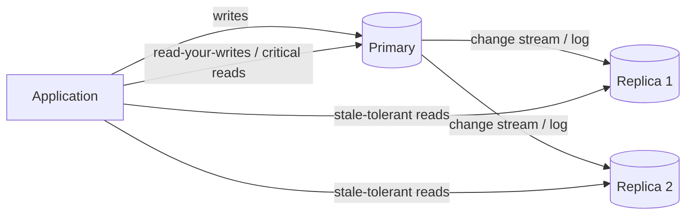

# DB-04 — Replication and Consistency

## Learning outcomes

- Explain why a database uses replication.
- Distinguish synchronous, asynchronous and semi-synchronous acknowledgment concepts.
- Explain replication lag and stale reads.
- Design read routing with an explicit consistency contract.
- Identify failover and split-brain risks.

## 1. Why replicate?

Replication maintains copies of data on more than one database node. Common goals include availability, disaster recovery, read scaling and serving users closer to their region. These goals are related but not identical. A replica that serves reads may be behind the primary; a standby that is not serving reads may be held for failover; neither is automatically a backup.

## 2. Primary/replica model

In a common topology, one primary accepts writes and one or more replicas apply changes from it. Replication may be asynchronous by default. This can improve write latency and allow replicas to lag, but a read sent to a replica immediately after a write may not see that write.

A design must define consistency requirements per read path:

- **Eventual/stale-tolerant read:** a feed or analytics view may tolerate some lag.
- **Read-your-writes:** after a user changes a profile, subsequent reads for that user should reflect the change.
- **Strong/current read:** account balance or payment status may require reading from the authoritative primary or using a stronger engine-specific guarantee.

Do not route every read to replicas merely because replicas exist.

## 3. Replication modes and their trade-offs

- **Asynchronous:** primary acknowledges without waiting for replica application/acknowledgment. Lower write latency, but a failover may lose transactions not replicated.
- **Semi-synchronous:** acknowledgment waits for a defined replica-side receipt/persistence milestone; exact semantics depend on the product. It is not synonymous with all replicas applying the transaction before the client receives success.
- **Synchronous:** commit waits for configured standby acknowledgment. Stronger durability/consistency properties under the documented failure model, but adds latency and availability dependencies.

Always inspect the exact engine's definition of acknowledgment and failure behavior.

## 4. Failover is a correctness problem

When the primary fails, a controller or operator chooses a replica to promote. Risks include:
- promoting a replica that is missing recent acknowledged writes;
- stale clients continuing to write to the old primary;
- two nodes accepting writes (split brain);
- connection pools continuing to point to an old endpoint;
- replication topology not being reconfigured correctly.

A failover plan needs fencing/leadership control, endpoint discovery, application reconnection, and a defined data-loss policy.

## 5. Read-after-write strategies

Possible approaches:
- Read the just-written entity from the primary for a bounded period.
- Carry a session/consistency token or log position and route to a replica known to have applied it, if the engine exposes a safe mechanism.
- Use sticky primary reads for a session.
- Accept bounded staleness for specific endpoints and document it.

Each option adds routing complexity or load to the primary. The right choice depends on the product's consistency contract.

## Exercise

A service has one primary and two read replicas. Users update shipping addresses and then immediately view their order. Product catalogue pages can tolerate 2 seconds of staleness. Design read routing separately for the two paths. Specify behavior during failover and what the user sees if the replica is lagging.

## Knowledge check

1. Why is replication not equivalent to backup?
2. What is replication lag?
3. What could go wrong if reads are sent to replicas immediately after every write?
4. Why is “synchronous” not a sufficient specification without product-specific semantics?
5. Name two controls that reduce split-brain risk.

## Topology sketch

The diagram is conceptual. The replication protocol, acknowledgment semantics, promotion and fencing mechanism are database/product-specific.

## Answer guide

1. A deletion/corruption can be replicated. Backups provide a historical recovery point separate from current replicated state.
2. Replication lag is the difference between the source's committed state and the state applied/visible on a replica, usually measured in time, log position or bytes.
3. The replica may not yet have applied the write, so the user may see stale data or not find a newly created row.
4. Products define acknowledgment at different points (received, written, flushed, applied, majority-committed, etc.) and under different failure models.
5. Examples: fencing the old primary, consensus/lease-based leader control, controlled promotion, and ensuring clients use a single authoritative endpoint.

## References

- System Design Primer — Replication: https://github.com/donnemartin/system-design-primer#availability-patterns
- PostgreSQL 18 — High Availability and Replication: https://www.postgresql.org/docs/current/high-availability.html
- PostgreSQL 18 — Log-Shipping Standby Servers: https://www.postgresql.org/docs/current/warm-standby.html
- MySQL 8.4 — Replication: https://dev.mysql.com/doc/refman/8.4/en/replication.html
- MongoDB — Replication and Replica Set Fundamentals: https://www.mongodb.com/docs/manual/replication/
