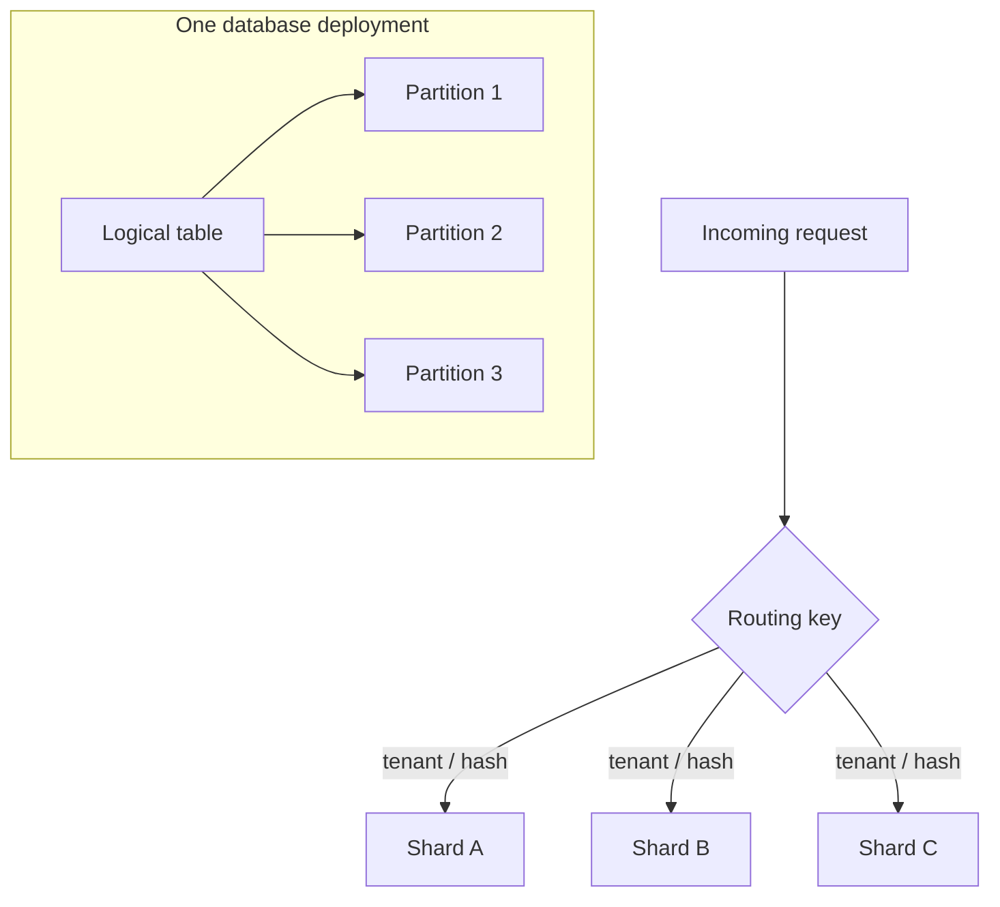

# DB-05 — Partitioning and Sharding

## Learning outcomes

- Distinguish table partitioning from distributed sharding.
- Compare range, hash and list partitioning/sharding at a conceptual level.
- Select a candidate partition key from query and retention patterns.
- Identify hot partitions, skew and cross-partition query costs.
- Explain why resharding is an operational project, not just a formula change.

## 1. Partitioning versus sharding

**Table partitioning** splits one logical table into smaller physical partitions managed within a database system. It can improve pruning, maintenance and locality for suitable workloads. It does not automatically distribute writes across independent database servers.

**Sharding** distributes subsets of data across multiple database nodes or clusters. It can increase storage and throughput capacity, but moves complexity into routing, rebalancing, cross-shard operations, uniqueness, joins and failure handling.

The terms are sometimes used loosely in industry. State exactly which mechanism is being discussed.

## 2. Common strategies

- **Range:** assign values to ranges (e.g. event date by month). Useful for time-range scans and data retention; risk of hot newest range under write-heavy append workloads.
- **Hash:** hash a key and distribute across a fixed or managed set of partitions. Can spread load; range queries across the key may touch many partitions.
- **List:** assign known categories/regions/tenants to partitions. Easy to understand for bounded categories; can become uneven and awkward as categories grow.
- **Directory-based:** maintain a mapping from key/tenant to shard. Flexible placement, but the directory becomes critical infrastructure.

## 3. Choosing a key

Evaluate:
- cardinality and distribution;
- read/write frequency by key;
- whether the key is present in common queries;
- growth and retention behavior;
- hot customers or tenants;
- need for local joins/transactions;
- resharding and migration strategy.

A monotonically increasing timestamp can be convenient for range partitioning but may direct most writes to the newest range. A low-cardinality status field is often a poor hash/shard key because activity can concentrate on few values.

## 4. Hot partitions and skew

A system can have many partitions and still bottleneck on one hot key. Measure distribution and request volume, not only total record count. Strategies include adding entropy to the key, write sharding/suffixes, isolating very large tenants, or redesigning the access pattern. These techniques often make reads and aggregation more complicated.

## 5. Operational consequences of sharding

Before sharding, consider whether vertical scaling, indexes, query redesign, caching, archival or built-in table partitioning can solve the actual bottleneck. Sharding adds:
- routing and metadata;
- cross-shard query/aggregation complexity;
- distributed transaction constraints;
- unique-key design constraints;
- rebalancing and backfill operations;
- uneven shard failure and capacity management.

## Exercise

A multi-tenant audit-event table grows by 300 million rows per month. Most queries filter by tenant and time range; compliance requires deleting data after 18 months. Propose (a) a table partitioning strategy for one database and (b) a sharding strategy only if a single database is insufficient. Discuss whether tenant ID alone is a safe shard key when one tenant is 20% of the traffic.

## Knowledge check

1. Does PostgreSQL table partitioning automatically mean data is stored across many database servers?
2. Why can range partitioning by current timestamp create a hot write partition?
3. What is a hot key?
4. Why do cross-shard joins become more expensive or complex?
5. Give two alternatives to sharding that should be evaluated first.

## Strategy sketch

The top row represents distributed sharding; the bottom row represents table partitioning within a database deployment. They are different design layers.

## Answer guide

1. No. PostgreSQL declarative partitioning divides a logical table into partitions managed by PostgreSQL; it does not inherently distribute them over independent database servers.
2. New writes cluster on the newest range, creating uneven write load until a new range is created or another distribution method is used.
3. A key receiving a disproportionate fraction of requests or writes, causing one partition/shard to saturate while others are underused.
4. Related rows may live on different nodes. Joins/aggregations require data movement or scatter-gather, and transactions may require distributed coordination.
5. Tune queries/indexes, vertically scale, partition tables, archive old data, improve caching or redesign the workload.

## References

- System Design Primer — Database / Sharding: https://github.com/donnemartin/system-design-primer#database
- PostgreSQL 18 — Table Partitioning: https://www.postgresql.org/docs/current/ddl-partitioning.html
- MongoDB — Sharding Introduction and Architecture: https://www.mongodb.com/docs/manual/sharding/
- DynamoDB — Partition Key Design: https://docs.aws.amazon.com/amazondynamodb/latest/developerguide/bp-partition-key-design.html
