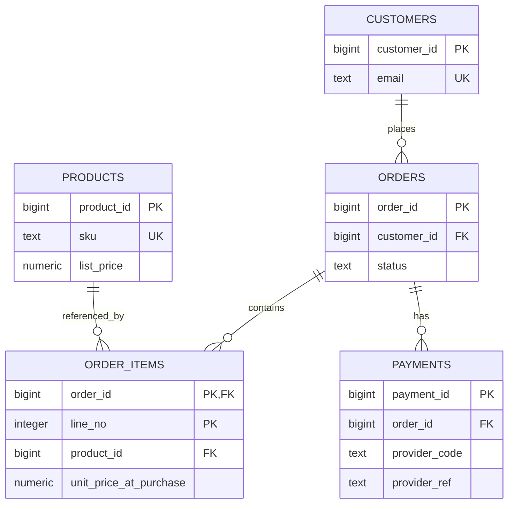

# DB-01 — Mô hình hóa dữ liệu và nền tảng quan hệ

## Learning outcomes / Kết quả học tập

Sau bài này, bạn có thể:

1. Chuyển yêu cầu nghiệp vụ và các cách đọc/ghi dữ liệu thành entities, relationships và constraints.
2. Chọn primary key, foreign key và unique key để biểu diễn các invariant đã nêu.
3. Giải thích một update anomaly và cách mô hình hóa chuẩn hóa giảm việc lặp lại, cập nhật lệch một sự thật.
4. Quyết định khi nào một read model dẫn xuất có thể đáng cân nhắc, đồng thời nêu chi phí đồng bộ.
5. Phân biệt invariant nào có thể được bảo vệ bằng constraint của cơ sở dữ liệu với kiểm tra thuộc luồng ứng dụng hoặc dịch vụ bên ngoài.

## Vì sao cần mô hình hóa trước khi tạo bảng?

Một dịch vụ bán hàng cần trả lời những câu hỏi như: khách hàng nào đặt đơn, mỗi đơn gồm sản phẩm nào, giá nào đã được chấp nhận, và một payment reference thuộc nhà cung cấp nào? Nếu mọi thứ được đặt trong một bảng rộng, thông tin khách hàng và sản phẩm có thể bị lặp lại ở nhiều hàng. Khi một sự thật thay đổi, các bản sao có thể không được cập nhật cùng nhau.

Mô hình hóa dữ liệu bắt đầu bằng việc nói rõ **sự thật nghiệp vụ nào cần lưu**, **điều gì phải luôn đúng**, và **ứng dụng cần đọc hoặc thay đổi dữ liệu theo cách nào**. Đây là cách tổ chức suy nghĩ cho bài toán này; nó không quy định một schema vật lý duy nhất cho mọi DBMS. Tài liệu MongoDB cũng khuyến nghị mô hình theo access pattern trong phạm vi thiết kế MongoDB, nhưng không nên biến khuyến nghị sản phẩm đó thành quy luật áp dụng nguyên xi cho mọi hệ quan hệ. [MongoDB Data Modeling — “Model Data for Access Patterns”](https://www.mongodb.com/docs/manual/data-modeling/)

## Bắt đầu từ yêu cầu, invariant và cách đọc/ghi

Trước khi viết DDL, lập một danh sách ngắn:

| Câu hỏi | Ví dụ trong dịch vụ đơn hàng |
|---|---|
| Ta đang lưu những thực thể nào? | Customer, Product, Order, OrderItem, Payment |
| Quan hệ giữa chúng là gì? | Một customer có thể có nhiều order; một order có thể có nhiều order item |
| Điều gì phải luôn đúng? | Mỗi order thuộc một customer; quantity lớn hơn 0; item tham chiếu product có thật |
| Ứng dụng cần đọc dữ liệu thế nào? | Tải order theo ID; liệt kê order của customer theo thời gian; tải các item của một order |
| Sự thật nào có thể thay đổi? | Tên sản phẩm và giá niêm yết có thể đổi sau khi mua |

Access pattern giúp ta biết cần hỗ trợ những thao tác nào. Nó là đầu vào cho quyết định, không tự nó chứng minh một index hay cách lưu cụ thể sẽ nhanh hơn. Index được học riêng trong DB-02.

## Worked example: dữ liệu cho đơn hàng

Giả sử một yêu cầu nghiệp vụ nói: “Sau khi khách hàng đặt hàng, hệ thống phải giữ được số tiền đã thỏa thuận, kể cả khi giá niêm yết thay đổi.” Với invariant đó, một mô hình có thể lưu `unit_price_at_purchase` trên mỗi order item. Đây là một lựa chọn để bảo toàn lịch sử giao dịch, không phải yêu cầu phổ quát của mô hình quan hệ; hệ thống có price history hoặc catalog version bất biến có thể chọn cách khác.



Ký hiệu `o{` cho order items có nghĩa một order có thể đang có 0 hoặc nhiều item. Foreign key từ item sang order chỉ đảm bảo mỗi item tham chiếu một order hợp lệ; nó **không** bảo đảm mỗi order có ít nhất một item. Nếu nghiệp vụ yêu cầu order phải có item trước khi chuyển sang trạng thái `confirmed`, phải nêu rõ invariant đó và nơi thực thi, chẳng hạn trong luồng xác nhận có transaction phù hợp. Không nên vẽ `|{` nếu DDL và quy trình không bảo đảm điều đó.

DDL dưới đây là ví dụ theo **PostgreSQL 18**, để nghĩa của constraint được cụ thể. Nó chưa được chạy trong môi trường khai báo, nên xem là minh họa chứ chưa phải mã đã kiểm thử. Các kiểu dữ liệu và chi tiết DDL cần được rà lại nếu chuyển sang engine khác.

```sql
CREATE TABLE customers (
    customer_id BIGINT PRIMARY KEY,
    email       TEXT NOT NULL UNIQUE,
    full_name   TEXT NOT NULL,
    created_at  TIMESTAMPTZ NOT NULL
);

CREATE TABLE products (
    product_id  BIGINT PRIMARY KEY,
    sku         TEXT NOT NULL UNIQUE,
    name        TEXT NOT NULL,
    list_price  NUMERIC(14, 2) NOT NULL CHECK (list_price >= 0)
);

CREATE TABLE orders (
    order_id    BIGINT PRIMARY KEY,
    customer_id BIGINT NOT NULL,
    status      TEXT NOT NULL,
    created_at  TIMESTAMPTZ NOT NULL,
    CONSTRAINT orders_customer_fk
        FOREIGN KEY (customer_id) REFERENCES customers(customer_id)
);

CREATE TABLE order_items (
    order_id              BIGINT NOT NULL,
    line_no               INTEGER NOT NULL,
    product_id            BIGINT NOT NULL,
    quantity              INTEGER NOT NULL CHECK (quantity > 0),
    unit_price_at_purchase NUMERIC(14, 2) NOT NULL CHECK (unit_price_at_purchase >= 0),
    PRIMARY KEY (order_id, line_no),
    CONSTRAINT order_items_order_fk
        FOREIGN KEY (order_id) REFERENCES orders(order_id),
    CONSTRAINT order_items_product_fk
        FOREIGN KEY (product_id) REFERENCES products(product_id)
);

CREATE TABLE payments (
    payment_id   BIGINT PRIMARY KEY,
    order_id     BIGINT NOT NULL,
    provider_code TEXT NOT NULL,
    provider_ref  TEXT NOT NULL,
    amount        NUMERIC(14, 2) NOT NULL CHECK (amount >= 0),
    status        TEXT NOT NULL,
    created_at    TIMESTAMPTZ NOT NULL,
    CONSTRAINT payments_order_fk
        FOREIGN KEY (order_id) REFERENCES orders(order_id),
    CONSTRAINT payments_provider_reference_uq
        UNIQUE (provider_code, provider_ref)
);
```

Các giả định của ví dụ:

- ID được cung cấp bởi ứng dụng hoặc cơ chế cấp ID được chọn riêng; ví dụ không dạy cơ chế sinh ID.
- `NUMERIC(14,2)` giả định nghiệp vụ đang biểu diễn một loại tiền có hai chữ số thập phân và giới hạn số phù hợp. Chính sách tiền tệ, rounding và precision phải được xác định theo domain; không sao chép kiểu này máy móc cho mọi loại tiền.
- Payment reference chỉ cần duy nhất **trong phạm vi một provider**. Nếu provider bảo đảm reference duy nhất toàn cục, hoặc domain có khóa khác, có thể chọn constraint khác.
- Một đơn hàng có thể tạm thời chưa có item trong lúc tạo. Nếu order không được xác nhận khi chưa có item, quy tắc đó phải được kiểm tra trong luồng xác nhận; các foreign key ở trên không biểu diễn được yêu cầu “cha phải có ít nhất một con”.

PostgreSQL 18 định nghĩa primary key là duy nhất và không null; foreign key bảo vệ tham chiếu tới hàng được tham chiếu; `CHECK` kiểm tra biểu thức trên hàng được chèn/cập nhật. `CHECK` không thay thế `NOT NULL` vì biểu thức null không đồng nghĩa false, và không dùng constraint này để kiểm tra invariant qua nhiều hàng hoặc bảng. [PostgreSQL 18 — Constraints, §§5.5.1–5.5.5](https://www.postgresql.org/docs/18/ddl-constraints.html)

Không gọi ví dụ trên là SQL portable: MySQL 8.4 bỏ qua dạng column-level inline `REFERENCES`; MySQL cần foreign key được khai báo dưới dạng table-level `FOREIGN KEY`. MySQL cũng có thể tạo index cho cột tham chiếu khi cần, nên chi tiết index của PostgreSQL không được khái quát hóa sang MySQL. [MySQL 8.4 — CREATE TABLE, §15.1.20](https://dev.mysql.com/doc/refman/8.4/en/create-table.html), [MySQL 8.4 — Foreign Key Constraints, §15.1.20.5](https://dev.mysql.com/doc/refman/8.4/en/create-table-foreign-keys.html)

## Keys và constraints: chọn theo invariant

- **Primary key** định danh một hàng; có thể gồm nhiều cột, ví dụ `(order_id, line_no)` để định danh một dòng trong order. PostgreSQL 18 mô tả primary key là duy nhất và không null. [PostgreSQL 18 — Constraints, §5.5.4](https://www.postgresql.org/docs/18/ddl-constraints.html)
- **Foreign key** ngăn một giá trị tham chiếu tới hàng không tồn tại trong quan hệ đã khai báo. Nếu thiếu giá trị không hợp lệ, cần `NOT NULL` riêng; foreign key không tự loại bỏ null. [PostgreSQL 18 — Constraints, §§5.5.2, 5.5.5](https://www.postgresql.org/docs/18/ddl-constraints.html)
- **Unique constraint** diễn đạt một khóa ứng viên phải duy nhất trong phạm vi đã chọn. Ví dụ `provider_ref` trong bài này duy nhất theo cặp `(provider_code, provider_ref)`, vì giả định mỗi nhà cung cấp chỉ cam kết duy nhất trong phạm vi của họ.
- **Check constraint** phù hợp cho điều kiện trên cùng hàng như `quantity > 0` hoặc `ends_at > starts_at`. Nó không diễn đạt được mọi quy tắc nghiệp vụ.
- **Not-null constraint** thể hiện một cột bắt buộc có giá trị. Chọn `NOT NULL` chỉ khi domain không chấp nhận vắng mặt.

Chọn natural key hay surrogate key là quyết định theo domain. Hãy hỏi: giá trị đó có ổn định không, có thể thay đổi không, phạm vi duy nhất là toàn hệ thống hay chỉ trong một provider/tenant, và thay đổi khóa sẽ ảnh hưởng bao nhiêu quan hệ? Không có câu trả lời chung rằng một loại khóa luôn nhỏ hơn, nhanh hơn hoặc an toàn hơn cho mọi schema.

Một constraint unique trong database cũng giúp bảo vệ invariant khi có nhiều writer hoặc nhiều đường ghi. Luồng “đọc xem đã tồn tại chưa, nếu chưa thì insert” có thể gặp race giữa lần đọc và ghi; database phải là điểm cuối cùng bảo vệ tính duy nhất, còn ứng dụng cần xử lý lỗi constraint một cách có chủ đích. Đây không có nghĩa database constraint thay thế validation thân thiện với người dùng.

Với PostgreSQL, primary key/unique của bảng được tham chiếu có index, nhưng foreign key **không tự tạo index trên phía tham chiếu**. Có nên thêm index ở đó phụ thuộc truy vấn và thao tác xóa/cập nhật ở bảng cha. DB-02 sẽ hướng dẫn cách cân nhắc index từ workload và query plan. [PostgreSQL 18 — Constraints, §5.5.5](https://www.postgresql.org/docs/18/ddl-constraints.html)

## Chuẩn hóa, lặp dữ liệu và đồng bộ

Chuẩn hóa giúp đặt mỗi sự thật vào vị trí phù hợp để giảm lặp dữ liệu và các lần cập nhật cần đồng bộ. Ví dụ nếu email hoặc địa chỉ customer bị sao chép vào nhiều order rows, đổi địa chỉ có thể chỉ cập nhật một phần các bản sao. Tài liệu nhập môn về normalization mô tả việc giảm redundancy và các phụ thuộc không nhất quán; các tình huống trong bài là ví dụ minh họa, không phải định nghĩa đầy đủ mọi anomaly. [Microsoft Learn — Database normalization basics, “Description of normalization” và “Second normal form”](https://learn.microsoft.com/en-us/previous-versions/troubleshoot/microsoft-365/microsoft-365-apps/access/database-normalization-description)

Chuẩn hóa không phải mục tiêu tối đa bằng mọi giá. Giả sử một màn hình dashboard cần trả về danh sách meeting kèm số participant rất thường xuyên. Hệ thống có thể giữ số participant dẫn xuất để đọc đơn giản hơn, nhưng khi participant được thêm/xóa, bộ đếm cũng phải cập nhật đúng; lỗi giữa chừng, retry hoặc xóa trùng có thể làm số liệu lệch. Đây là một ứng viên để thử nghiệm nếu workload thật cho thấy cần thiết, không phải bảo đảm rằng denormalization sẽ làm hệ thống nhanh hơn.

Khi lưu giá đã chốt trên order item, lý do phải là invariant “giá giao dịch của order đã xác nhận không thay đổi theo catalog”. Nếu giá được truy xuất từ price history bất biến, snapshot có thể không cần thiết. Hãy nêu domain rule trước rồi mới chọn cách lưu.

Với một số domain, business rule nằm một phần ở database và một phần ở ứng dụng. Ví dụ `ends_at > starts_at` là điều kiện của cùng một meeting row và có thể đặt thành `CHECK`. Trái lại, “meeting phải có ít nhất hai participant trước khi gửi notification” liên quan tới nhiều hàng và một hành động bên ngoài; cần transaction/application workflow hoặc cơ chế khác được thiết kế rõ. Không giả định một `CHECK` trên một hàng sẽ bảo vệ được invariant xuyên nhiều bảng. [PostgreSQL 18 — Constraints, §5.5.1](https://www.postgresql.org/docs/18/ddl-constraints.html)

## Trade-offs và lỗi thường gặp

| Quyết định | Khi hữu ích | Chi phí hoặc rủi ro |
|---|---|---|
| Tách entities và tham chiếu bằng khóa | Sự thật được dùng ở nhiều nơi và cần giữ nhất quán | Đọc dữ liệu có thể cần join; migration và constraint rollout cần kế hoạch |
| Dùng composite key cho row có phạm vi cục bộ | Ví dụ `line_no` chỉ có ý nghĩa trong một order | Quan hệ tham chiếu cần mang đủ các cột trong khóa |
| Snapshot dữ liệu giao dịch | Domain cần giữ nguyên sự thật tại thời điểm giao dịch | Cần định nghĩa trường nào là snapshot và cách sửa sai/hoàn tiền |
| Denormalize dữ liệu dẫn xuất | Có read path cụ thể cần đơn giản hóa và lợi ích được đo | Đồng bộ, retry, backfill, sửa sai và xử lý partial failure |
| Đặt invariant ở database | Nhiều writer phải tuân cùng quy tắc | Writer phải xử lý constraint violation; thay đổi constraint có thể cần migration cẩn trọng |

Lỗi thường gặp là lấy display name hoặc email làm ID bất biến mà chưa xét việc đổi giá trị; dùng check-then-insert thay cho unique constraint khi invariant là tính duy nhất; nhầm FK với tự động tạo mọi index cần thiết; hoặc dùng kiểu tiền mà không ghi giả định về currency và rounding.

## Practical exercise / Bài tập thực hành

Thiết kế schema cho ứng dụng đặt lịch họp. Yêu cầu:

- Một user có thể tạo nhiều meeting; mỗi meeting có đúng một organizer.
- Meeting có nhiều participant; mỗi user chỉ xuất hiện một lần trong cùng meeting.
- Participant có thể `accepted`, `declined` hoặc `tentative`.
- `ends_at` phải sau `starts_at`.
- Các màn hình cần đọc: danh sách meeting sắp tới của một user; danh sách participant của một meeting.
- Meeting nháp có thể chưa có participant. Meeting không được chuyển sang `confirmed` nếu thiếu organizer; hệ thống chưa định nghĩa yêu cầu số participant tối thiểu.

**Nộp:** ERD; DDL cho ít nhất ba bảng; chỉ rõ primary/foreign/unique/check constraints; liệt kê hai read pattern và chỉ ra dữ liệu nào mỗi thao tác cần. Không cần chọn hoặc biện minh index trong bài này; index mechanics thuộc DB-02.

**Yêu cầu đánh giá:** mô hình phải cho phép kiểm tra duplicate participant bằng khóa/unique constraint; điều kiện thời gian phải được thể hiện; giải thích một invariant có thể đặt trong database và một invariant thuộc trạng thái/luồng ứng dụng.

### Sample solution / Một lời giải mẫu

Một thiết kế hợp lý gồm `users`, `meetings`, `meeting_participants`. ID được ứng dụng cấp trong ví dụ này.

```sql
CREATE TABLE users (
    user_id BIGINT PRIMARY KEY,
    email   TEXT NOT NULL UNIQUE
);

CREATE TABLE meetings (
    meeting_id  BIGINT PRIMARY KEY,
    organizer_id BIGINT NOT NULL REFERENCES users(user_id),
    starts_at   TIMESTAMPTZ NOT NULL,
    ends_at     TIMESTAMPTZ NOT NULL,
    status      TEXT NOT NULL,
    CHECK (ends_at > starts_at)
);

CREATE TABLE meeting_participants (
    meeting_id BIGINT NOT NULL REFERENCES meetings(meeting_id),
    user_id    BIGINT NOT NULL REFERENCES users(user_id),
    response   TEXT NOT NULL CHECK (response IN ('accepted', 'declined', 'tentative')),
    PRIMARY KEY (meeting_id, user_id)
);
```

Khóa chính `(meeting_id, user_id)` ngăn user được thêm hai lần vào cùng meeting. Foreign key ngăn participant/organizer tham chiếu tới user không tồn tại. `CHECK (ends_at > starts_at)` kiểm tra hai giá trị cùng hàng. Trạng thái `confirmed` có organizer được đảm bảo bởi `organizer_id NOT NULL`; nếu quy tắc tương lai yêu cầu tối thiểu hai participant, kiểm tra đó phải được thiết kế trong transaction/workflow xác nhận vì nó đếm các hàng ở bảng khác.

Rubric 100 điểm:

| Tiêu chí | Điểm |
|---|---:|
| Entities và quan hệ organizer/participant được biểu diễn đúng | 20 |
| PK/FK và tính duy nhất của participant được bảo vệ | 25 |
| Invariant thời gian và response hợp lệ được nêu/biểu diễn | 20 |
| Hai read pattern gắn với đúng dữ liệu và quan hệ | 15 |
| Phân biệt một DB invariant với một quy tắc thuộc application workflow; nêu một trade-off hoặc giả định | 20 |

Các schema khác vẫn có thể đạt điểm tối đa nếu bảo vệ cùng invariant, nêu rõ giả định và giải thích trade-off. Index selection không được chấm ở bài này vì learner chưa học DB-02.

## Knowledge check / Kiểm tra kiến thức

1. Với requirement lưu lại giá khách đã đồng ý lúc đặt hàng, bạn cần lưu sự thật nào trên order item? Nêu một domain thay thế có thể khiến snapshot không cần thiết.
2. Foreign key từ `meeting_participants.user_id` sang `users.user_id` bảo vệ invariant gì? Nó có buộc mọi user phải là participant của ít nhất một meeting không?
3. Một team lưu địa chỉ customer vào mỗi order row. Nêu một update anomaly và giải thích tách customer thành entity riêng giúp gì.
4. Vì sao “query xem participant đã tồn tại chưa, rồi insert” không đủ để bảo đảm không trùng khi có nhiều writer? Constraint nào làm hàng rào cuối cùng?
5. Dashboard cần hiển thị count participant cho từng meeting. Nêu điều kiện workload khiến bạn cân nhắc lưu count dẫn xuất, và hai việc phải làm để giữ nó đúng.
6. Với PostgreSQL 18, khai báo foreign key có tự tạo index trên cột phía tham chiếu không? Trả lời kèm điều kiện khi nào cân nhắc index đó; không khái quát sang DBMS khác.
7. Nên đặt `ends_at > starts_at` ở đâu? Quy tắc “phải có tối thiểu hai participant trước khi xác nhận meeting” khác gì về phạm vi dữ liệu?
8. Nếu hai payment provider có thể cấp cùng một `provider_ref`, unique key nào phù hợp với giả định đó?

### Answer key / Đáp án và giải thích

1. Lưu `unit_price_at_purchase` nếu business invariant yêu cầu giữ nguyên giá đã chốt. Nếu mỗi catalog price được lưu trong một phiên bản bất biến và order giữ phiên bản đó, hệ thống có thể truy xuất giá theo phiên bản thay vì snapshot trực tiếp. Đây là lựa chọn domain, không phải quy luật của relational DB.
2. FK đảm bảo giá trị `user_id` trong participant tham chiếu tới user có thật (nếu giá trị không null). Nó không buộc mọi user phải tham gia meeting; ràng buộc đó là chiều ngược lại và thường không phải requirement.
3. Một địa chỉ đổi nhưng chỉ một số order row được cập nhật, khiến cùng một customer có nhiều địa chỉ được xem như hiện tại. Tách customer giúp lưu một bản sự thật hiện tại; nếu cần địa chỉ lịch sử tại thời điểm giao hàng thì đó là requirement khác và cần snapshot/version phù hợp.
4. Hai writer có thể cùng đọc thấy “chưa tồn tại” trước khi một writer ghi. Unique/primary-key constraint là điểm thực thi tính duy nhất; ứng dụng cần xử lý conflict thay vì giả định insert luôn thành công.
5. Cân nhắc khi một read path cụ thể lặp lại, lợi ích được đo và chấp nhận chi phí ghi. Phải cập nhật count trong cùng cơ chế nhất quán với thay đổi participant, và xử lý retry/backfill/reconciliation để khắc phục lỗi lệch.
6. Không. PostgreSQL 18 không tự tạo index ở bảng tham chiếu khi khai báo FK. Cân nhắc index nếu workload truy vấn hoặc thao tác delete/update ở bảng cha cần tìm các hàng con; quyết định dựa vào pattern và query plan. MySQL có semantics khác.
7. `ends_at > starts_at` chỉ dùng dữ liệu của cùng meeting row, nên là ứng viên cho `CHECK`. Điều kiện tối thiểu hai participant đếm các hàng khác trong bảng participant và thường phải được bảo vệ trong luồng xác nhận/transaction hoặc cơ chế khác.
8. `UNIQUE (provider_code, provider_ref)` nếu reference chỉ duy nhất trong phạm vi provider. Nếu provider đảm bảo global uniqueness, domain có thể chọn khóa khác; phải ghi assumption trước.

## Outcome-to-assessment mapping / Mapping outcome sang assessment

| Outcome | Assessment |
|---|---|
| 1. Chuyển yêu cầu/access pattern thành entity, quan hệ, constraints | Exercise: liệt kê read patterns, dựng ERD/DDL; rubric tiêu chí 1 và 4; Q2 |
| 2. Chọn PK/FK/unique key phù hợp invariant | Exercise rubric tiêu chí 2; Q2, Q8 |
| 3. Giải thích normalization giảm update anomaly | Q3; exercise rubric tiêu chí 5 yêu cầu nêu fact ownership |
| 4. Quyết định khi nào cân nhắc denormalization và chi phí đồng bộ | Q5; exercise rubric tiêu chí 5 |
| 5. Phân biệt DB-enforceable invariant với application workflow | Exercise rubric tiêu chí 3 và 5; Q4, Q7 |

## References / Tài liệu tham khảo

- PostgreSQL Global Development Group, [PostgreSQL 18 — Constraints](https://www.postgresql.org/docs/18/ddl-constraints.html), §§5.5.1–5.5.5: `CHECK`, `NOT NULL`, `UNIQUE`, primary key, foreign key và index phía tham chiếu.
- PostgreSQL Global Development Group, [PostgreSQL 18 — Numeric Types](https://www.postgresql.org/docs/18/datatype-numeric.html), §§8.1.2–8.1.3: exact `numeric`/`decimal` và floating-point; ví dụ tiền cần precision/rounding theo domain.
- Oracle, [MySQL 8.4 — CREATE TABLE](https://dev.mysql.com/doc/refman/8.4/en/create-table.html), §15.1.20; [Foreign Key Constraints](https://dev.mysql.com/doc/refman/8.4/en/create-table-foreign-keys.html), §15.1.20.5: cú pháp và semantics riêng cho foreign key.
- Microsoft Learn, [Database normalization basics](https://learn.microsoft.com/en-us/previous-versions/troubleshoot/microsoft-365/microsoft-365-apps/access/database-normalization-description), “Description of normalization” và “Second normal form”: tài liệu nhập môn về redundancy và dependencies; không dùng nó làm bằng chứng cho claim performance.
- MongoDB, [Data Modeling](https://www.mongodb.com/docs/manual/data-modeling/), “Model Data for Access Patterns”: tham khảo theo sản phẩm, current manual; không dùng như quy luật chung cho relational schema.
- Donne Martin, [System Design Primer — Database](https://github.com/donnemartin/system-design-primer#database): dùng để tham khảo vùng chủ đề, không phải nguồn duy nhất cho semantics kỹ thuật.

## Scope and source notes / Ghi chú phạm vi và nguồn

Các tài liệu PostgreSQL và MySQL được kiểm tra ngày 2026-11-09; semantics nêu ở trên giới hạn theo phiên bản ghi trong từng tham chiếu. Tài liệu MongoDB là current manual và chưa pin server version. DDL là ví dụ PostgreSQL 18 nhưng **chưa được chạy** trong môi trường khai báo. Chưa có lab kiểm thử SQL, timing với học viên, hoặc review pháp lý.

Phạm vi nội dung và tổ chức chủ đề có tham khảo *The System Design Primer* của Donne Martin, repo ghi license CC BY 4.0. Lời giải thích, ví dụ đơn hàng, diagram, bài tập, câu hỏi và đáp án ở đây được viết mới; không sao chép hình ảnh hoặc đoạn văn của Primer. Không hàm ý tác giả Primer xác nhận hay bảo trợ khóa học.
