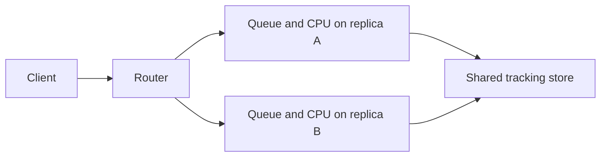

A parcel-tracking API responds quickly during the day but slows when a carrier sends a batch of delivery notifications. The team can buy one faster server or run two slower ones. The decision depends on where requests spend time and which resource runs out of capacity during the burst.

## Learning outcomes

- **M01-L02-LO1.** Trace a request through processing and waiting, then estimate throughput, backlog and steady-state concurrency from a workload model.
- **M01-L02-LO2.** Defend a scaling choice using the limiting resource, state placement, behavior under failure and measurements at a common service target.

## Measure the request and the workload

**Latency** is elapsed time per request, measured here from the client sending it to receiving the response. It includes work, network time and waiting. **Throughput** is the rate of completed requests. Record the offered request rate, successful completions and errors separately. For a deadline of 75 ms, the rate of successful responses within 75 ms is the **goodput** under that deadline. For successful requests, nearest-rank p99 is the smallest observed latency at or below which at least 99% of observations fall. Report which requests and time window it covers, and count rejections and timeouts alongside it. [Google SRE, The Four Golden Signals](https://sre.google/sre-book/monitoring-distributed-systems/#xref_monitoring_golden-signals) · [AWS Builders' Library, Using load shedding to avoid overload](https://builder.aws.com/content/3Eun1EEyX6p2e3VYNyRLSJzLuMV/using-load-shedding-to-avoid-overload)

**Performance** describes what a given deployment delivers under a stated workload. **Scalability** describes how much more work it can support as resources increase. For an API, compare the highest sustainable offered rate that meets the same p99 and error targets at each resource allocation. Hold the request mix and dataset fixed for that comparison. One deployment can have better low-load latency while another can serve more requests within the target during a burst. [Werner Vogels, A Word on Scalability](https://www.allthingsdistributed.com/2006/03/a_word_on_scalability.html)

## Trace the burst and the queue

Suppose the API receives 120 requests/s normally and 230 requests/s for two seconds. The target is successful-request p99 ≤ 75 ms and at most 0.5% errors and timeouts, assessed over repeated bursts and their recovery. Each request does a CPU stage and reads once from a shared store. The API can process other requests while the store read is outstanding. Assume enough connections for that overlap, negligible routing overhead, an initially empty CPU queue, constant rates within each interval, and first-in, first-out service at each worker. All numbers are model inputs.

The router sends each request to one API replica. The replica waits for its CPU slot, runs the CPU work and sends the store read. The reply returns through that same replica. With one server, the router has a single destination.

| Deployment | CPU work per request | CPU capacity | Arrival rate per server during burst |
| --- | ---: | ---: | ---: |
| A · One faster server with one CPU slot | 5 ms | 200 requests/s | 230 requests/s |
| B · Two slower servers with one CPU slot each | 8 ms | 125 requests/s each, 250 in total | 115 requests/s with an even split |

Assume the store initially supports 300 reads/s. At low load, A saves 3 ms of CPU time per request. During the burst, A's CPU stage completes 200 requests/s, up from 120. Its queue still grows at `230 − 200 = 30 requests/s`. It ends the burst with about `30 × 2 = 60` waiting requests. An arrival near the end waits about `60 ÷ 200 = 0.30 s` before it gets CPU time. Once arrivals return to 120/s, the queue drains in about `60 ÷ (200 − 120) = 0.75 s`. This is how throughput can rise while the slow requests get slower. [Google SRE, Queue Management](https://sre.google/sre-book/addressing-cascading-failures/#queue-management)

B's two CPUs can keep up with the evenly split burst in the model. The modeled arrival rate uses 92% of each CPU's capacity. A brief arrival spike or a few expensive requests can consume that spare capacity and create a queue. The fluid calculation exposes a queueing problem for A and identifies B as the candidate to test. The actual p99 depends on the distribution of arrival gaps, service times and dependency delays. [Dean and Barroso, The Tail at Scale, pp. 74–75](https://www.barroso.org/publications/TheTailAtScale.pdf#page=1)

### Estimate concurrency in steady state

Little's Law, `L = λW`, relates mean requests in the system (`L`), request rate (`λ`) and mean time inside the system (`W`). Use the same boundary and request population for all three. Suppose a separate steady run has 120 admitted requests/s, all complete, and a mean of 4.8 requests in flight between API admission and response. Then the mean time inside that boundary is `4.8 ÷ 120 = 0.040 s`, or 40 ms. In-flight requests include those waiting and those being processed, including the store call. Use a long, stable window with no growing backlog and finite averages. For the two-second interval with a growing queue, use the burst calculation. For p99, measure the latency distribution. [Little, A Proof for the Queuing Formula L = λW, p. 383](https://fisherp.scripts.mit.edu/wordpress/wp-content/uploads/2015/11/ContentServer.pdf#page=1)

## Choose the change that removes the bottleneck

**Scale up** when a larger instance can speed up the resource that dominates the path. A is a candidate for a lighter workload with a strict low-load latency target. Check the actual improvement per request and the cost of the larger server. One server also leaves the API without compute capacity if that server fails. **Scale out** when parallel requests can use additional instances. B buys more aggregate CPU capacity and can keep serving normal traffic on one replica in this model (`125 > 120`). That survivor has little headroom and cannot absorb the full burst. A burst shorter than instance startup requires capacity already running or a deliberate overload policy. [Microsoft, Design infrastructure to scale](https://learn.microsoft.com/en-us/azure/well-architected/performance-efficiency/scale-partition#design-infrastructure-to-scale)

State placement can invalidate B's even split. If local session state forces 60% of the burst to one replica, it receives `0.60 × 230 = 138 requests/s` against 125 requests/s of capacity. Its queue grows while the other replica has spare CPU. To make requests movable, design this read so either instance can validate it and fetch its state from the same store. If the change adds calls to a session store, measure the latency and throughput of that dependency as part of the request path. [Microsoft, Design application to scale](https://learn.microsoft.com/en-us/azure/well-architected/performance-efficiency/scale-partition#design-application-to-scale)

If the shared tracking store can sustain only 180 reads/s, B can send it all 230 reads/s under the same even split and overlap assumptions. Its store queue then grows at 50 reads/s in the model. Adding more API replicas leaves that store ceiling at 180 completed reads/s. Profile the store work and reduce per-request demand or increase capacity there. If a burst exceeds safe capacity, a bounded queue with prompt rejection can protect admitted work. Count those rejections against the error budget and account for retries in the offered load. [Microsoft, Design to scale out](https://learn.microsoft.com/en-us/azure/architecture/guide/design-principles/scale-out#recommendations) · [AWS Builders' Library, Using load shedding to avoid overload](https://builder.aws.com/content/3Eun1EEyX6p2e3VYNyRLSJzLuMV/using-load-shedding-to-avoid-overload)

## Benchmark and profile the request path

Replay the same request mix, data and offered-rate schedule on both deployments. Start at low load to measure the work on the path, raise the rate in sustained steps to find where service targets start to fail, and replay the two-second bursts with time to recover. Drive arrivals on a schedule independent of response times so a slow deployment still sees the intended burst. Repeat with realistic routing skew and one replica unavailable. Record the actual offered rate, timely completions, latency histograms and the rates of timeouts and rejections. Keep burst results visible alongside steady-state results. [Microsoft, Test scaling](https://learn.microsoft.com/en-us/azure/well-architected/performance-efficiency/scale-partition#test-scaling) · [Google SRE, Choosing an Appropriate Resolution for Measurements](https://sre.google/sre-book/monitoring-distributed-systems/#choosing-an-appropriate-resolution-for-measurements)

Break down slow requests into API queue time, on-CPU work, connection acquisition and store time. If the API queue grows while the store has spare capacity, a CPU profile can identify work to optimize and per-replica metrics can show whether adding capacity would distribute that work. If store waits rise while API CPUs are idle, inspect the store and connection pool to locate the wait before buying compute. Keep the offered load fixed when retesting a change. For the parcel API, advance B to the burst test and deploy it only if it meets the targets and the required behavior with a replica down. [Google SRE, The Four Golden Signals](https://sre.google/sre-book/monitoring-distributed-systems/#xref_monitoring_golden-signals)
