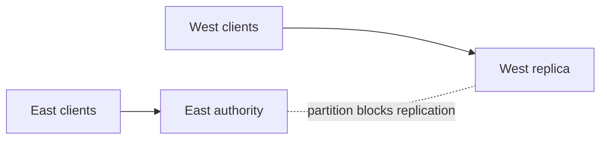

A payment application's profile page can tolerate showing an old display name for a short time. Its balance screen promises to show the current confirmed balance. Both endpoints use replicas in two regions. When the regions cannot communicate, their different promises lead to different responses.

## Learning outcomes

- **M01-L03-LO1.** Trace replica reads, writes and reconciliation through an observable history and identify the guarantees each result satisfies.
- **M01-L03-LO2.** Choose and defend an operation's partition policy, session guarantee and conflict handling using its user-visible requirements.

## Read and write histories

An operation has an invocation and a response. A completed write returns success before a later read is invoked when the two do not overlap. A consistency contract restricts which values that read may return.

Assume a profile field starts as `Mira` in East and West. East accepts `display_name = Lin` and acknowledges it. Before replication reaches West, a reader asks West for the name and gets `Mira`.

| Contract for this read | Meaning for the history |
| --- | --- |
| Weak | The contract permits the stale result. The application must say what, if any, freshness guarantee it offers. |
| Eventual | The stale result can occur during propagation. If updates stop, communication resumes, all updates arrive and conflicts are resolved consistently, replicas converge. The guarantee supplies no fixed convergence deadline or read-your-writes promise. |
| Strong, defined here as linearizable | The stale result violates the contract because the acknowledged write finished before this read started and there was no later write. |

For a linearizable read/write object, completed operations must fit a legal sequential history that respects the real-time order of nonoverlapping operations. If a read overlaps the `Lin` write, either `Mira` or `Lin` can be legal in this two-operation example, depending on where the read falls in that order. The name “strong” needs a specified contract because systems use it with different scopes. [Herlihy and Wing, §2.2](https://www.cs.cmu.edu/~wing/publications/HerlihyWing90.pdf#page=6) · [Vogels, Client-side Consistency](https://www.allthingsdistributed.com/2008/12/eventually_consistent.html)

## Choose operations during a partition

Assume East holds the authority for a linearizable balance object, and East and West can serve local clients. A partition cuts all East–West communication. A client at East successfully writes a new balance of 80, replacing 100. The write completes before a West client asks for the current balance. West cannot tell whether East accepted that write. In another possible history, East accepted no write and the correct value remains 100. West sees the same local information in both histories.

To honor the balance contract, West must obtain a current answer from an authority that can establish the latest committed state. If it cannot, it can wait within the client's deadline and then return `unavailable`. The client receives a response but the current-value read did not complete successfully. A system might instead expose a separately named last-known balance with an explicit stale-data contract. It must not present that value as a current confirmed balance.

For an ordinary public profile read, the API can return West's last applied `Mira` with a stale-data contract. This preserves a local useful response during isolation while allowing the acknowledged `Lin` update to be temporarily invisible. The application should surface or otherwise account for the possible staleness when it matters to the user.

The CAP result formalizes the conflict for a replicated read/write object in an asynchronous network with messages lost across a partition. **C** is linearizability and **A** means each request received by a non-failing node completes with a valid response, without a fixed time bound. A percentage availability objective and an HTTP error rate measure different operational properties. With a partition, an operation that keeps the linearizable contract may be unable to complete at an isolated node. A locally completing operation can instead choose a weaker consistency contract. These are often called CP and AP policies for the operation. Healthy operation and different endpoints can use different policies. [Gilbert and Lynch, §§2–3](https://groups.csail.mit.edu/tds/papers/Gilbert/Brewer6.pdf#page=3) · [Brewer, CAP Twelve Years Later](https://www.infoq.com/articles/cap-twelve-years-later-how-the-rules-have-changed/)

The balance read above promises only a current value. A subsequent authorization and debit need their own atomic rule, such as a coordinated check-and-update that prevents the account's allowed balance from being spent twice. Reading a current value alone does not enforce that invariant when two payments race.

## Preserve a session and reconcile edits

Suppose a user writes `Lin` at East and immediately moves to West. A **read-your-writes** contract requires a successful session read to include the user's prior write, subject to later writes. One implementation returns a session token with the acknowledged write and serves the read only from a snapshot that includes it. West can route to an eligible replica, wait for replication within the deadline, or return `unavailable` when no eligible snapshot is reachable. Returning `Mira` as a successful read breaks this session contract even when ordinary profile reads allow stale values. [Terry et al., Session Guarantees, §3.1](https://pages.cs.wisc.edu/~remzi/Classes/739/Papers/bayou-sessions94.pdf#page=3)

For a simple single ordered profile history, let `7` identify the acknowledged update. A replica may serve a token `7` when its **same-history, contiguous applied prefix** includes entry 7 and its read snapshot includes that prefix. A replica with independent regional counter `7` has not thereby proved it includes East's entry 7. Concurrent multi-writer histories need a way to identify the required writes, such as per-origin write sets or version vectors, together with an inclusion check. [Terry et al., §5](https://pages.cs.wisc.edu/~remzi/Classes/739/Papers/bayou-sessions94.pdf#page=7)

Now suppose profile edits are allowed independently in both regions during the partition. East changes the display name to `Lin` and West changes it to `Ari`. One possible application rule selects the edit with the larger unique edit ID from a fixed total order. After both replicas receive both edits, applying the same rule produces the same winner. If `Ari` wins, the user's `Lin` edit is lost from the displayed field. For edits to different fields, a per-field merge can preserve both, if the application defines that rule and both replicas use it. Convergence requires all relevant updates to arrive and replicas to apply the same deterministic resolution. It does not make the selected value the one either user intended. [Terry et al., Managing Update Conflicts, §5](https://www.scs.stanford.edu/nyu/01fa/sched/bayou.pdf#page=4)

**BASE** describes a design approach commonly expanded as basically available, soft state and eventually consistent. A profile view can change when a delayed update arrives even when no client has just submitted a new request. The design still needs an explicit operation contract, conflict policy and recovery path. [Pritchett, An ACID Alternative](https://web.stanford.edu/class/cs245/spr2019/readings/base.pdf#page=4)

For a product-specific illustration, DynamoDB global tables version 2019.11.21 in **multi-Region eventual consistency (MREC)** mode asynchronously replicate between Regions. AWS resolves concurrent same-item updates using its internal timestamp ordering. A strongly consistent read in one Region can still miss an update made in another Region. The documentation's mode and item scope matter when choosing a profile contract and its conflict policy. [AWS DynamoDB, Versions and Multi-Region eventual consistency](https://docs.aws.amazon.com/amazondynamodb/latest/developerguide/V2globaltables_HowItWorks.html)
