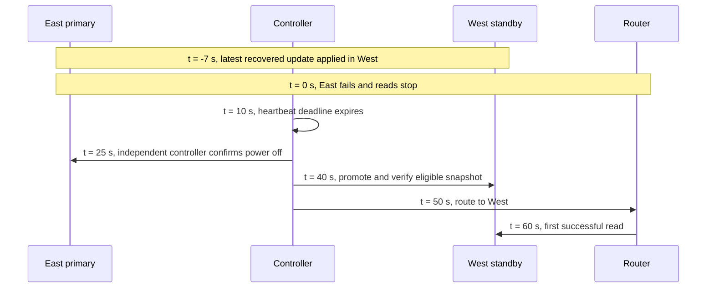

A regional order-status service has a standby in another region. A network interruption stops heartbeats from the primary. The operator must restore reads and decide when the standby may accept writes. That decision depends on the required data freshness, the ability to exclude the old writer, and the time and data-loss budgets.

## Learning outcomes

- **M01-L04-LO1.** Trace a failover timeline and calculate its outage, recovery point and availability budget under stated assumptions.
- **M01-L04-LO2.** Choose traffic and recovery policies using availability, freshness, capacity and common-cause failure evidence.

## Choose traffic roles and standby readiness

In **active-passive** operation, one region serves normal traffic and another is prepared to take over. A cold standby needs capacity started or provisioned and may need data restored. A warm standby runs at reduced capacity and must scale up. In this lesson, a hot standby is provisioned for the intended takeover load. It still needs health, capacity and data-freshness checks before it is usable. Cold capacity can reduce idle cost but lengthen recovery. A prepared standby incurs ongoing cost and operational work. These definitions describe this design's readiness levels. [AWS, Disaster recovery options](https://docs.aws.amazon.com/whitepapers/latest/disaster-recovery-workloads-on-aws/disaster-recovery-options-in-the-cloud.html)

In **active-active** operation, both regions serve ordinary traffic. If either region fails, the remaining region needs enough capacity and working routing for the redirected load. Both regions can serve reads while one authority handles writes. If both accept writes to the same objects, choose coordination or a conflict policy that preserves each operation's contract. Active-active traffic does not by itself specify the consistency of those writes. [AWS, Multi-site active/active](https://docs.aws.amazon.com/whitepapers/latest/disaster-recovery-workloads-on-aws/disaster-recovery-options-in-the-cloud.html)

Heartbeat loss means the monitor cannot hear the primary. A failed server and a network partition can produce the same signal. Promoting a standby while the original writer can still accept writes risks **split brain**, where two authorities accept conflicting updates. Before enabling the standby writer, the controller needs verified **fencing** that excludes the old writer. If it cannot verify exclusion, the standby keeps writes disabled. Reads may continue only where their freshness contract permits the available snapshot. [PostgreSQL 18, Failover](https://www.postgresql.org/docs/18/warm-standby-failover.html) · [Red Hat Enterprise Linux 10, Configuring fencing](https://docs.redhat.com/en/documentation/red_hat_enterprise_linux/10/html/configuring_and_managing_high_availability_clusters/configuring-fencing)

## Trace a two-region recovery

Suppose East normally serves order-status reads and is the only writer. West has a hot read replica and can be promoted. The read endpoint requires a snapshot no more than ten seconds behind the latest acknowledged update at the instant of failure. The recovery time objective, or **RTO**, is 45 seconds from interruption to the first successful read. The recovery point objective, or **RPO**, allows at most five seconds of lost acknowledged updates at that failure. These values and the timeline are model inputs.

An independent management path can reach East's power controller even when the service network cannot. The controller confirms power off and prevents East from restarting as a writer until it rejoins as a replica. West's applied snapshot contains all updates acknowledged through `t = −7 s`, and the latest acknowledged update at East occurred at `t = 0 s`. Thus the snapshot is seven seconds behind at the failure and meets this example's ten-second read-freshness condition. The interruption is `60 − 0 = 60 s`, exceeding the 45-second RTO by 15 seconds. The recovery point is seven seconds before failure, exceeding the five-second RPO by two seconds. The scenario supplies the actual recovered point. A recent lag observation alone would not establish this bound. [AWS, Define recovery objectives](https://docs.aws.amazon.com/wellarchitected/latest/reliability-pillar/rel_planning_for_recovery_objective_defined_recovery.html)

If the power controller cannot confirm fencing at 25 seconds, West remains read-only and promotion to writer waits. The first acceptable read may still succeed if routing, capacity and the ten-second freshness contract hold. Write availability remains separately impaired. Fixing the slowest recovery stage or reserving prepared capacity can improve RTO. Reducing asynchronous exposure or requiring a suitable remote acknowledgment can improve the recovery point, with added latency or reduced write availability when the remote acknowledgment is unavailable.

## Replication and recovery points

Replication maintains another copy that may serve reads or become a promotion candidate. With asynchronous replication, a primary can acknowledge an update before the standby has durably received it. Promotion after primary loss can therefore omit acknowledged updates. A synchronous remote acknowledgment can reduce that exposure for its configured acknowledgment and failure conditions. Receipt, durable storage and visibility to a reader are distinct stages. PostgreSQL 18 exposes different acknowledgment choices for its own synchronous replication configuration. [PostgreSQL 18, Streaming and synchronous replication](https://www.postgresql.org/docs/18/warm-standby.html#SYNCHRONOUS-REPLICATION)

Single-writer replication is sometimes called **primary-replica** or **master-slave** replication. A multi-writer system, historically called **master-master**, needs an explicit coordination or reconciliation policy for concurrent changes. Separate those writer roles from active-active read traffic. Replication can also copy an accidental deletion or corruption to every live replica. An independently retained backup and log archive provide an earlier recovery point if they are usable and retained long enough. Restore exercises establish whether the data and restore time meet the service objectives. [PostgreSQL 18, Continuous archiving and point-in-time recovery](https://www.postgresql.org/docs/18/continuous-archiving.html)

## Convert an availability target into a budget

Define a time-based availability SLI over a 30-day window of `30 × 86,400 = 2,592,000 s`. Assume the service is either available or unavailable for the measured operation and there are no excluded periods. The permitted unavailable time is `(1 − target) × window`.

| Availability target | Permitted downtime in 30 days |
| --- | ---: |
| 99.9% | 2,592 s, or 43 min 12 s |
| 99.99% | 259.2 s, or 4 min 19.2 s |

The modeled 60-second interruption uses 60 seconds of that window's time budget. At 99.99%, `259.2 − 60 = 199.2 s` remains for other interruptions. A request-based SLI instead divides successful eligible requests by total eligible requests. It can represent partial failures that a binary time model hides. Choose and report the denominator before comparing a measured result to its target. [Google SRE, Availability table](https://sre.google/sre-book/availability-table/) · [Google SRE, Measuring service risk](https://sre.google/sre-book/embracing-risk/#measuring-service-risk)

## Model serial, parallel and shared dependencies

Suppose each regional read path is usable with probability 0.99 at a randomly selected instant in the same window. Usable includes sufficient capacity, a valid snapshot and all region-specific routing. If the application requires both independent components A and B, their serial availability is `0.99 × 0.99 = 0.9801`, or 98.01%. If either independent regional path alone can serve the full request, its parallel availability is `1 − (1 − 0.99)² = 0.9999`, or 99.99%. These calculations assume independent up/down events and omit switching interruptions. [AWS, Availability with dependencies](https://docs.aws.amazon.com/whitepapers/latest/availability-and-beyond-improving-resilience/availability-with-dependencies.html) · [AWS, Availability with redundancy](https://docs.aws.amazon.com/whitepapers/latest/availability-and-beyond-improving-resilience/availability-with-redundancy.html)

Now add a shared identity service that must be available for either regional path. Assume its availability is 0.999 and the paths are conditionally independent with availability 0.99 each while identity is up. The overall probability becomes `0.999 × 0.9999 = 0.9989001`, or 99.89001%. Shared identity failure can affect both regions at once. A common deployment bug, shared network dependency or inadequate survivor capacity can also prevent the parallel estimate from describing actual service. Define usable branches and obtain the relevant joint or conditional failure evidence before relying on the arithmetic.

Use the timeline to identify which stages determine recovery and use the dependency model to identify which failures affect both regions. Compare a provisioned standby against cold capacity using measured recovery time and cost. Test a region loss, a failed fence and a stale standby separately. Record client-visible read and write failures, recovery point and restoration time for the chosen contracts.
